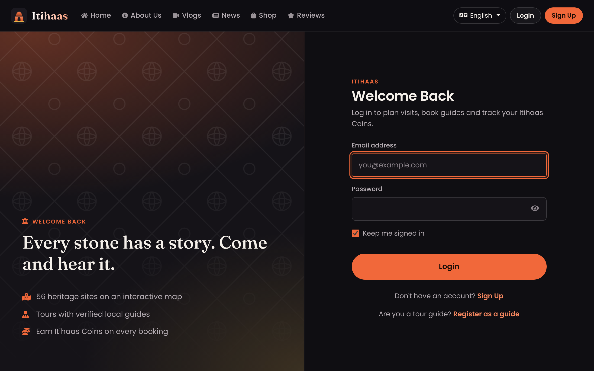
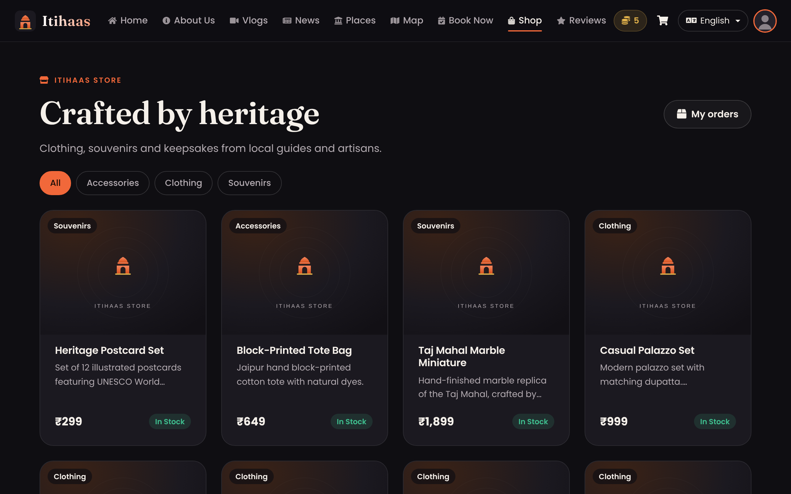
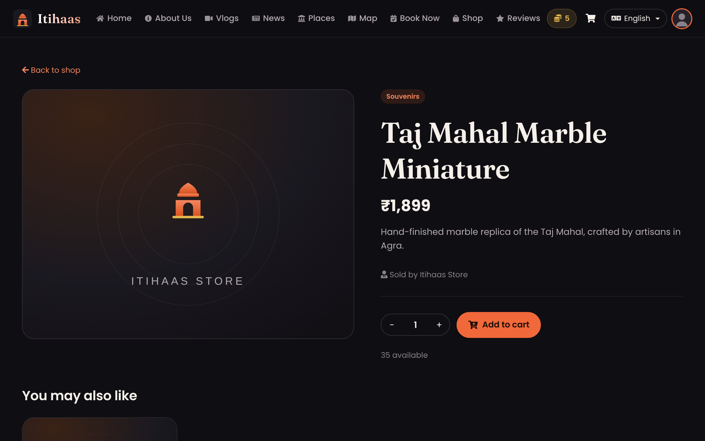
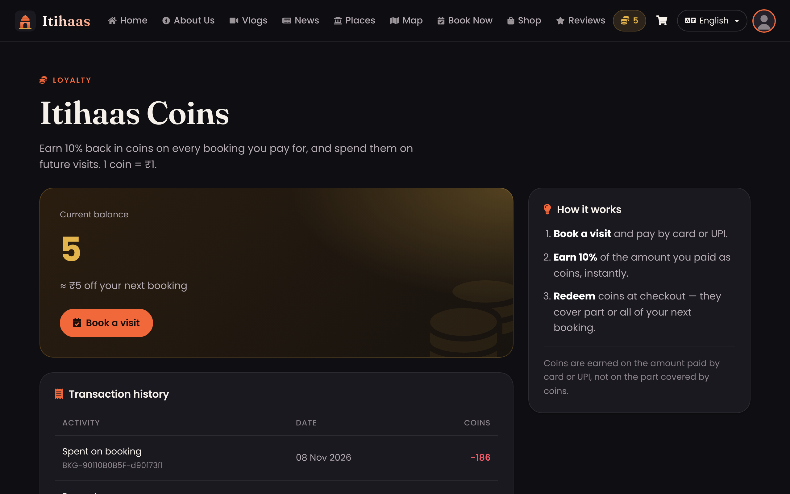
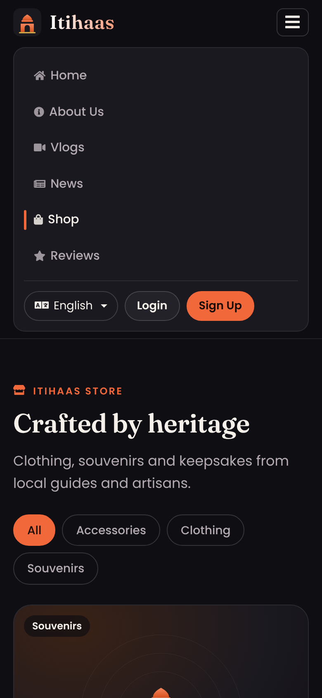
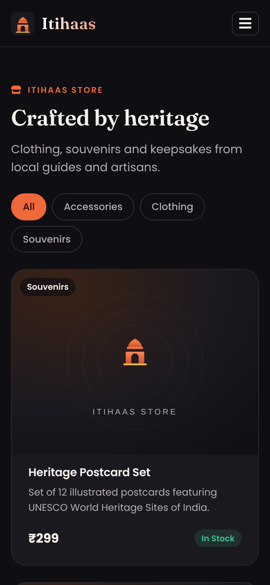
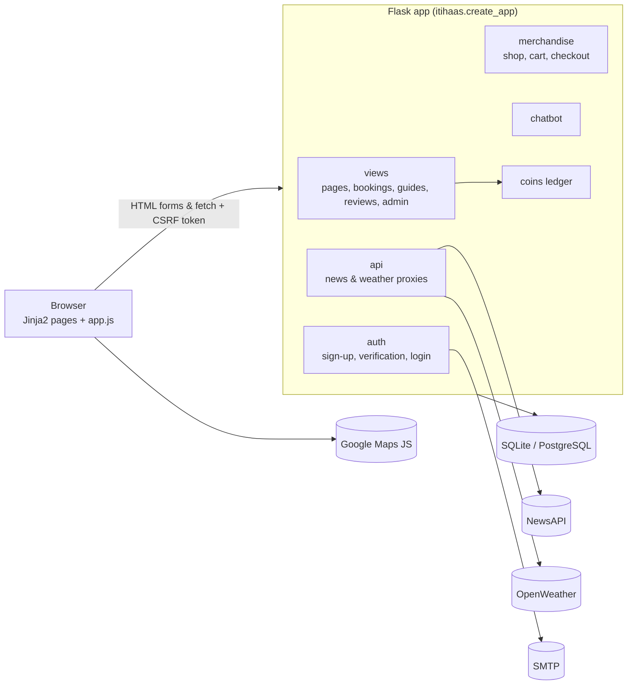

<div align="center">


# Itihaas

**Discover, book and celebrate India's heritage — monuments, local guides, festival calendars and maps in one place.**

[](https://github.com/stashlop/Itihaas/actions/workflows/ci.yml)


[](LICENSE)

[Features](#-key-features) ·
[Screenshots](#-screenshots) ·
[Quick start](#-getting-started) ·
[API](#-api-reference) ·
[Deployment](#-deployment) ·
[Contributing](CONTRIBUTING.md)

</div>

---

## 📖 Overview

*Itihaas* (इतिहास) means **"history"** in Hindi. It is a Flask web application that
brings India's heritage sites together with the people who keep their stories alive:
travellers can explore monuments on a map, plan a day, book visits, hire verified local
guides and buy souvenirs, while guides can publish tour packages and sell products.

The project began as a **Colloquium 2025 — IT for Society** project and was revived and
modernised in 2026 (see the [CHANGELOG](CHANGELOG.md) and the
[repository audit](docs/AUDIT.md) that preceded the work).

### The problem

Information for heritage travel in India is scattered: opening hours and fees on one
site, guides found by word of mouth, festival calendars somewhere else, and little
incentive to come back. Itihaas puts discovery, planning, booking and local expertise
into a single, multilingual experience.

> [!NOTE]
> **All payments are simulated.** Card, UPI and cash-on-delivery flows exist for
> demonstration only — no money is charged and card details are never sent to the server.

## ✨ Key features

| | Feature | Details |
|---|---|---|
| 🏛️ | **Monument booking** | Multi-step booking for individual visits or guide packages, with booking history and cancellation |
| 🪙 | **Itihaas Coins** | Earn 10 % back on every booking paid by card/UPI and redeem coins on the next one — fully server-side, with a transaction ledger |
| 🗺️ | **Heritage map** | 56 heritage sites and 17 heritage hotels on Google Maps, with live weather in pop-ups (OpenWeather) |
| 🧭 | **Plan My Day** | Itinerary generator by city, time available, interests and pace |
| 🧑‍🏫 | **Tour guides** | Guide registration (licence, languages, specialisations, sites), dashboard to accept tour requests and manage packages |
| 🛍️ | **Shop** | Catalogue with categories, cart with stock checks, checkout and order history; guides can list products |
| ⭐ | **Reviews** | Ratings, tags, photo uploads and persisted comments |
| 💬 | **Monuments Assistant** | Rule-based chatbot with timings, fees, transport, food and shopping for major monuments |
| 📰 | **News** | Heritage & tourism headlines via a server-side NewsAPI proxy |
| 🌐 | **9 languages** | English, हिंदी, தமிழ், ಕನ್ನಡ, मराठी, ગુજરાતી, भोजपुरी, മലയാളം, తెలుగు (untranslated strings fall back to English) |
| 🔐 | **Accounts** | E-mail verification with 6-digit codes, CSRF protection, secure sessions, role-based admin dashboard |

## 📸 Screenshots

| Sign in | Shop |
|---|---|
|  |  |
| **Product** | **Itihaas Coins ledger** |
|  |  |

<p align="center">
  
  &nbsp;&nbsp;
  
</p>

> [!IMPORTANT]
> The original photos, videos and audio referenced by the home, places, vlog and map pages
> were never committed to this repository, so those pages show designed placeholders.
> See [Media assets](#-media-assets) to add your own.

## 🧰 Technology stack

| Layer | Technology |
|---|---|
| Backend | [Flask 3.1](https://flask.palletsprojects.com/), Flask-Login, Flask-WTF (CSRF), Flask-Mail, Flask-Migrate |
| Data | [SQLAlchemy 2.0](https://www.sqlalchemy.org/) via Flask-SQLAlchemy — SQLite by default, PostgreSQL via `DATABASE_URL` |
| Frontend | Jinja2 templates, Bootstrap 4.6, jQuery 3.7, Font Awesome 5, Swiper, Leaflet, Chart.js — all **self-hosted** and version-pinned |
| Design | Custom design system (`itihaas/static/css/itihaas.css`), Poppins + Fraunces typography |
| Integrations | Google Maps JS API, OpenWeather, NewsAPI, Gmail SMTP, optional WhatsApp via `pywhatkit` |
| Quality | pytest (102 tests), Ruff, GitHub Actions on Python 3.11–3.13 |
| Serving | Gunicorn (`wsgi:app`) |

## 🏗️ Architecture



- **Application factory** — `itihaas.create_app()` wires configuration, extensions,
  blueprints, error handlers and security headers. Extensions live in
  `extensions.py` to avoid circular imports.
- **Configuration** — everything environment-specific comes from environment variables
  (or a `.env` file); see [`.env.example`](.env.example).
- **Server-authoritative business rules** — booking validation, coin spending/rewards
  and stock checks happen on the server; the browser only displays results.
- **Third-party keys stay on the server** — news and weather are proxied and cached.

## 📁 Project structure

```text
Itihaas/
├── itihaas/                    # Application package
│   ├── __init__.py             # create_app(): factory, error handlers, security headers
│   ├── config.py               # Config & TestingConfig (env-driven)
│   ├── extensions.py           # db, migrate, mail, csrf, login_manager
│   ├── models.py               # User, Booking, Guide, Review, ReviewComment, coins…
│   ├── merchandise_models.py   # Merchandise, CartItem, Order, OrderItem, Payment
│   ├── views.py                # Pages, bookings, guides, reviews, admin
│   ├── auth.py                 # Sign-up, verification, login
│   ├── merchandise.py          # Shop, cart, checkout, guide products
│   ├── api.py                  # /api/news and /api/weather proxies
│   ├── coins.py                # Itihaas Coins ledger
│   ├── chatbot.py              # Monuments Assistant
│   ├── cli.py / seed.py        # flask seed | create-admin | whatsapp-dispatch
│   ├── utils.py                # Validation, uploads, decorators
│   ├── data/heritage.py        # Heritage sites, hotels, festivals, states
│   ├── translations.py         # UI strings for 9 languages
│   ├── templates/              # Jinja2 templates (+ partials, errors, emails)
│   └── static/                 # css/, js/, img/, vendor/ (self-hosted libraries)
├── tests/                      # pytest suite
├── docs/                       # Audit report and screenshots
├── scripts/vendor.sh           # Re-downloads pinned front-end libraries
├── run.py                      # Development server
├── wsgi.py                     # Production entry point (gunicorn wsgi:app)
├── requirements.txt            # Runtime dependencies (pinned)
├── requirements-dev.txt        # + pytest, ruff
└── pyproject.toml              # Project metadata, pytest & ruff config
```

## 🚀 Getting started

### Prerequisites

- Python **3.11+**
- Optional: a Gmail account with an [App Password](https://support.google.com/accounts/answer/185833),
  and API keys for Google Maps, OpenWeather and NewsAPI

### Installation

```bash
git clone https://github.com/stashlop/Itihaas.git
cd Itihaas
python -m venv .venv
source .venv/bin/activate        # Windows: .venv\Scripts\activate
pip install -r requirements-dev.txt
cp .env.example .env             # Windows: copy .env.example .env
```

### Environment variables

Only `SECRET_KEY` is required in production; everything else is optional and the
related feature degrades gracefully when it is missing.

| Variable | Required | Purpose |
|---|---|---|
| `SECRET_KEY` | **Production** | Signs sessions and CSRF tokens. A random key is used in debug mode if unset. |
| `FLASK_DEBUG` | No | `1` for auto-reload and debug pages (development only). Defaults to `0`. |
| `DATABASE_URL` | No | SQLAlchemy URL. Defaults to SQLite at `instance/database.db`. |
| `ADMIN_EMAILS` | No | Comma-separated e-mails that may open `/admin-dashboard`. |
| `EMAIL_USER`, `EMAIL_PASSWORD` | No | SMTP credentials for verification e-mails. In debug mode without them, codes are printed to the server log. |
| `MAIL_SERVER`, `MAIL_PORT`, `MAIL_USE_TLS`, `MAIL_DEFAULT_SENDER` | No | SMTP settings (default: Gmail on port 587). |
| `GOOGLE_MAPS_API_KEY` | No | Enables the interactive map. Restrict the key to your domain. |
| `OPENWEATHER_API_KEY` | No | Weather in map pop-ups. |
| `NEWS_API_KEY` | No | Headlines on `/news`. |
| `SESSION_COOKIE_SECURE` | No | `1` when served over HTTPS. |
| `MAX_UPLOAD_MB` | No | Upload size limit (default 8). |
| `WHATSAPP_ENABLED` | No | `1` to send WhatsApp confirmations via `pywhatkit` (desktop only). |

Generate a secret key with:

```bash
python -c "import secrets; print(secrets.token_hex(32))"
```

### Run locally

```bash
flask --app itihaas seed         # optional: load demo products into the shop
python run.py                    # http://127.0.0.1:5000
```

or with the Flask CLI:

```bash
flask --app itihaas run --debug
```

Create an account at `/sign-up`. Without SMTP credentials and with `FLASK_DEBUG=1`, the
verification code appears in the terminal. To create an admin account:

```bash
flask --app itihaas create-admin you@example.com
```

…and add the same address to `ADMIN_EMAILS` in `.env`.

### Run the tests

```bash
pytest           # 102 tests
ruff check .     # lint
```

## 🔌 API reference

JSON endpoints used by the front end. All `POST`/`DELETE` requests need a CSRF token
in the `X-CSRFToken` header (the bundled `app.js` adds it automatically); 🔒 = login required.

| Method | Endpoint | Description |
|---|---|---|
| `GET` | `/health` | Liveness check: `{"status": "ok", "database": "ok"}` |
| `GET` | `/api/news?q=` | Heritage news (NewsAPI format). `503` if not configured |
| `GET` | `/api/weather?lat=&lng=` | Current weather for a coordinate. `503` if not configured |
| `GET` | `/api/get-tour-packages` | Active tour packages grouped by state |
| `POST` | `/api/process-booking-payment` 🔒 | Create a booking after a simulated payment (see below) |
| `POST` | `/api/cancel-booking` 🔒 | `{"booking_id"}` — cancel your own booking |
| `POST` | `/api/demo-payment` 🔒 | Simulated gateway for an existing booking (≈10 % random failures) |
| `POST` | `/api/reviews` 🔒 | Multipart: `monument_name`, `rating` (1–5), `review_text`, `tags` (JSON), `photos` |
| `GET` / `POST` | `/api/reviews/<id>/comments` 🔒 | List / add (`{"text"}`) comments |
| `POST` | `/api/update-profile-pic` 🔒 | Multipart `profile_pic` |
| `POST` | `/guide/manage-package` 🔒 guide | Create/update a tour package |
| `POST` | `/guide/delete-package` 🔒 guide | `{"package_id"}` |
| `GET` | `/guide/get-packages` 🔒 guide | Your packages |
| `POST` | `/guide/handle-request` 🔒 guide | `{"request_id", "action": "accept" \| "reject"}` |
| `POST` | `/chatbot/get_response` | Chatbot conversation step |
| `POST` | `/change-language` | `{"lang": "hi"}` |

<details>
<summary><strong>Example: booking with coins</strong></summary>

```http
POST /api/process-booking-payment
Content-Type: application/json
X-CSRFToken: <token>

{
  "bookingData": {
    "monument": "Taj Mahal", "state": "Uttar Pradesh", "visit_date": "2026-12-01",
    "visitors": 2, "amount": 1000, "name": "Asha", "email": "asha@example.com",
    "phone": "+91 98765 43210"
  },
  "paymentMethod": "card",
  "coinsToUse": 150
}
```

```json
{
  "status": "success", "booking_id": 12, "transaction_id": "BKG-3F9A1C0D2E",
  "amount": 1000.0, "coins_used": 150, "amount_paid": 850.0,
  "coins_earned": 85, "new_balance": 85, "message": "Payment successful and booking confirmed!"
}
```

Errors return `{"status": "error", "error": "<message>"}` with a 4xx status.
</details>

## ☁️ Deployment

Itihaas is a standard WSGI application. On any Linux host or PaaS (Render, Railway,
Fly.io, a VM…):

1. Set `SECRET_KEY`, `SESSION_COOKIE_SECURE=1`, `DATABASE_URL` (PostgreSQL recommended)
   and any integration keys as environment variables. Do **not** set `FLASK_DEBUG`.
2. Install dependencies: `pip install -r requirements.txt` (add a PostgreSQL driver such
   as `psycopg[binary]` if you use PostgreSQL).
3. Start the server:

   ```bash
   gunicorn wsgi:app --bind 0.0.0.0:$PORT --workers 2
   ```

4. Point your platform's health check at `/health`.

Tables are created automatically on start-up (`db.create_all()` only adds missing
tables). For schema changes to existing tables, initialise Alembic migrations with
`flask --app itihaas db init` and use `db migrate` / `db upgrade`.

Uploaded files are stored in `itihaas/static/uploads/`; use a persistent volume (or move
uploads to object storage) on hosts with ephemeral disks.

## 🖼️ Media assets

Page templates reference photos and videos under `itihaas/static/` (e.g. `agra.mp4`,
`red-fort.jpg`, `pl1.mp4`). They were not part of the original repository, so the app
shows placeholders instead of broken images. To restore them, add files with the same
names to `itihaas/static/` — only use media you have the rights to publish. To list the
expected filenames:

```bash
grep -rhoE "filename='[^']+'" itihaas/templates | sort -u
```

## 🗺️ Roadmap

- [ ] Real payment gateway (e.g. Razorpay) behind the existing simulated flows
- [ ] Server-side pricing for monuments and packages (amounts are currently client-calculated, then validated)
- [ ] Move heritage data, monument encyclopaedia and itineraries into the database with an admin UI
- [ ] Complete translations for all 9 languages and move to gettext/Flask-Babel catalogues
- [ ] Rate limiting for login and verification (e.g. Flask-Limiter)
- [ ] Alembic migrations and PostgreSQL in CI
- [ ] Split the very large legacy templates (booking, map, review) into components and extract inline JS/CSS
- [ ] Bootstrap 5 migration
- [ ] Replace `pywhatkit` with the WhatsApp Business Cloud API

## 🤝 Contributing

Contributions are welcome! Please read [CONTRIBUTING.md](CONTRIBUTING.md) for the
development setup, coding standards and pull-request checklist. Security issues: see
[SECURITY.md](SECURITY.md).

## 📄 License

Released under the [MIT License](LICENSE) © 2025 Stash Lopes.

## 🙏 Author & acknowledgements

- **Stash Lopes** — creator and maintainer ([@stashlop](https://github.com/stashlop))
- Built for **Colloquium 2025 — IT for Society**
- Heritage-site information inspired by the UNESCO World Heritage List and Indian
  tourism resources
- Open-source projects that make this possible: Flask, SQLAlchemy, Bootstrap, Font
  Awesome, Leaflet, Swiper and Chart.js
